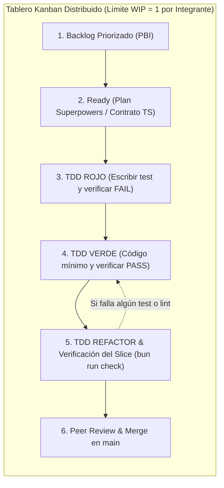

# 00. ÍNDICE MAESTRO Y GOBERNANZA METODOLÓGICA (TDD + KANBAN) — PROYECTO YUYAY

## Control Documental

| Campo | Detalle Técnico |
|---|---|
| **Proyecto** | **Yuyay** — Prototipo experimental de tamizaje neurológico con minijuegos (PWA Local y Offline) |
| **Certamen** | PoliByte Innovation Challenge 2026 — Fase 2 (Construcción de MVP y Gran Final) |
| **Categoría Principal** | Neurociencias (con captura local mediante Visión por Computador y Procesamiento de Voz) |
| **Metodología de Desarrollo** | **TDD (*Test-Driven Development* con Vitest) + Kanban Distribuido por Cortes Verticales** |
| **Equipo Desarrollador** | **Los JackersMainsters** (ESPOCH — Facultad de Informática y Electrónica — Carrera de Software, 8.º Semestre) |
| **Integrantes y Roles** | **Alexander Rafael Villalva Dumancela** (Líder, Interfaz y Juegos Cognitivos 2D) **Andrés Alexander Gaibor Apunte** (Arquitecto de Visión, Audio, Juegos Multimodales y DevOps) **Omar Santiago Figueroa Díaz** (Motor de Informes, Exportación, Soporte Offline, Persistencia y QA) |
| **Estación de Emisión** | **Estación Omar (`OMARFIGUEROA` / `DESKTOP-ML70LGD`)** |
| **Fecha de Emisión** | 15 de noviembre de 2026 |
| **Hito de Congelamiento** | Miércoles 25 de noviembre de 2026 (*Code Freeze* oficial en GitHub) |
| **Versión del Paquete** | `v2.0.0-TDD-KANBAN` (Sincronizado con commit `589fb73` de `yuyay`) |

---

## 1. Propósito de este Paquete Documental

El presente directorio (`Documentacion/Ingenieria Software/`) consolida la documentación formal de **Ingeniería de Software** del proyecto **Yuyay**, elaborada desde la **Estación Omar** bajo el enfoque metodológico **TDD (*Test-Driven Development*) + Kanban Distribuido**, tomando como fuentes primarias:

1. **La Propuesta Técnica Oficial aprobada en Fase 1:** `PROPUESTA/Yuyay/Yuyay_Propuesta_Tecnica_Fase1.txt` y el documento de resolución de dudas científicas `PROPUESTA/Yuyay/DudasTecnicasPropuestaYuyay.txt`.
2. **Los Mockups Oficiales de Interfaz de Usuario:** Ubicados en `PROPUESTA/mockups/`:
   - **Pliego 1 (`45de6305-9126-482c-ace6-13c713a2b844.jpg`):** *"Yuyay · Propuesta móvil"* (Pantallas 1 a 9: Bienvenida, Consentimiento *"Antes de empezar"*, Preparación y Dispositivos *"Prepara tu espacio"*, vistas en juego de los 5 minijuegos y vista de cierre *"Tu perfil"*).
   - **Pliego 2 (`26c8584f-18e1-4d89-b113-a7b3b41d9f8c.jpg`):** *"Yuyay · Movimiento y voz"* (Pantallas 16 a 21: Tutorial de *La pinza*, transición intermanual *"Ahora, la otra mano"*, *Sostén la bandeja* en reposo y brazos extendidos, y *Sonríe y habla* con vocal sostenida `"aaa"` y lectura en voz alta).
   - **Pliego 3 (`e808711f-d5de-42c9-a0ff-a47bd2d15e2a.jpg`):** *"Yuyay · Navegación y atención"* (Pantallas 22 a 27: Expresiones faciales, tutorial y juego de *El vuelo del cóndor*, brújula *"¿Dónde comenzaste?"*, y tutorial y juego de *Semáforo*).
3. **El Código Fuente y Reglas de Calidad del Repositorio `yuyay`:** Ubicado en `Desarrollo/yuyay/`, verificado mediante **Vitest 5**, **TypeScript 7 strict**, **Biome** y **GitHub Actions CI**.
4. **Las Bases Oficiales del Certamen:** `BASES/Bases_Concurso_poliByte_Challengue_2026.txt` (en especial la Rúbrica de la Gran Final de la Sección 9.2 —20 puntos por Arquitectura y Calidad Técnica— y el Anexo A.4 de Alcance Mínimo Exigido para el MVP).

---

## 2. Estructura del Paquete de Ingeniería de Software

El paquete está organizado en siete documentos técnicos modulares y trazables entre sí:

| N.º | Archivo | Estándar / Marco de Referencia | Contenido Principal |
|---|---|---|---|
| **00** | `00_Indice_Maestro_y_Gobernanza_TDD_Kanban.md` | TDD (Red-Green-Refactor) + Kanban | Índice general, justificación del cambio de SDD a **TDD + Kanban**, contexto de la Estación Omar y reconciliación entre Mockups y reglas ético-técnicas. |
| **01** | `01_Especificacion_Requisitos_Software_SRS.md` | ISO/IEC/IEEE 29148 / IEEE 830 | Especificación de Requisitos de Software completa: Reglas Invariables del Dominio (`RC`), Requisitos Funcionales (`RF-001` a `RF-027`), Requisitos No Funcionales (`RNF-001` a `RNF-013`) e interfaces con las 27 pantallas de los mockups. |
| **02** | `02_Catalogo_Historias_de_Usuario_BDD.md` | Agile INVEST + Gherkin BDD -> TDD | 20 Historias de Usuario (`HU-001` a `HU-020`) agrupadas en 8 Épicas, cuyos escenarios *Dado / Cuando / Entonces* sirven como especificación directa para los tests unitarios y de integración en Vitest. |
| **03** | `03_Especificacion_Casos_de_Uso_UML.md` | UML 2.5 / Cockburn Fully Dressed | Diagrama general de Casos de Uso, catálogo de actores y 12 Casos de Uso expandidos (`CU-001` a `CU-012`) con flujos principales, alternativos y de excepción (`"No evaluable"`). |
| **04** | `04_Product_Backlog_y_Tablero_Kanban_TDD.md` | Kanban WIP-Limited + TDD | Product Backlog priorizado (`PBI-001` a `PBI-032`) con MoSCoW, Story Points, archivo de prueba TDD asociado, flujo de columnas Kanban, *DoR*/*DoD* y plan operativo para la **Estación Omar**. |
| **05** | `05_Arquitectura_Diseno_UI_Mockups_y_Datos_SAD.md` | C4 Model + IEEE 1016 (SAD/SDD) | Arquitectura cliente 100 % local, mapeo detallado de las 27 pantallas de los Mockups a componentes React/Tailwind, diccionario de datos en Dexie v2 (`MeasurementRow`) y formulación matemática de las métricas. |
| **06** | `06_Plan_Pruebas_Validacion_y_Matriz_Trazabilidad_RTM.md` | IEEE 829 (STP) + TDD + RTM | Estrategia de pruebas TDD en 4 niveles, 20 Casos de Prueba (`CP-001` a `CP-020`), protocolo de certificación en hardware real y Matriz de Trazabilidad Bidireccional completa. |

---

## 3. Gobernanza Metodológica: Por qué se adopta TDD + Kanban (y se descarta SDD)

### 3.1. Razones Técnicas del Descarte de SDD (Spec Kit)
1. **Compatibilidad Nativa Multiplataforma (Windows 10/11 vs. macOS):** Dos de las tres estaciones del equipo (**Estación Omar** `OMARFIGUEROA` y **Estación Alexander** `DESKTOP-MO7Q55S`) operan sobre Windows, donde los scripts bash de `.specify/scripts/bash` no se ejecutan nativamente en PowerShell (`docs/instalacion.md`). Eliminar SDD suprime esa fricción y permite que los tres desarrolladores trabajen con un único runtime estándar: **Bun + Vitest (`bun test` / `bun run check`)**.
2. **Eliminación de Burocracia Redundante ante el *Code Freeze* (25/11):** Al disponer ya de este paquete formal de Ingeniería de Software (`SRS`, `Historias de Usuario`, `Casos de Uso`, `Product Backlog` y `SAD`), mantener carpetas intermedias de Spec Kit (`specs/NNN-*/{spec.md, plan.md, tasks.md}`) duplica esfuerzo documental en una ventana restante de 10 días.
3. **El Test Automatizado como Contrato Ejecutable (TDD):** En un sistema cuyos resultados dependen de algoritmos matemáticos deterministas (ciclos con histéresis, FFT, simetría geométrica, longitud de ruta y mediana de latencias) y reglas duras (`null` $\rightarrow$ `"No evaluable"`), un archivo `*.test.ts` en Vitest valida el requisito en tiempo real mucho mejor que un documento estático.

### 3.2. Flujo de Trabajo Combinado: Ciclo TDD (IBM + `obra/superpowers`) y Tablero Kanban Remoto

De conformidad con las referencias definidas en `Documentacion/Metodologia TDD.txt`:
- **Fundamento Teórico e Industrial de TDD:** [IBM — ¿Qué es el desarrollo guiado por pruebas (TDD)?](https://www.ibm.com/es-es/think/topics/test-driven-development) (Ciclo iterativo *Red $\rightarrow$ Green $\rightarrow$ Refactor*).
- **Instrumentación Práctica con `obra/superpowers`:** [https://github.com/obra/superpowers](https://github.com/obra/superpowers), cuya estructura ya reside en `Desarrollo/yuyay/docs/superpowers/{specs,plans}/` (`2026-11-07-yuyay-estructura-design.md` y `2026-11-07-yuyay-estructura.md`). Cada tarea dentro de un plan de `superpowers` exige explícitamente:
  1. **Step 1:** Escribir el test que falla (`*.test.ts`).
  2. **Step 2:** Ejecutar `bun run test` y confirmar que falla (`Expected: FAIL`).
  3. **Step 3:** Implementar el código mínimo para pasar el test.
  4. **Step 4:** Ejecutar `bun run test` y confirmar que pasa (`Expected: PASS`).
  5. **Step 5 (Verificación del slice):** Refactorizar y ejecutar el comando exacto de verificación (`bun run check` / `bun run build`) comprobando el resultado observable.

- **Regla de Oro de TDD en Yuyay:** Ningún minijuego (`src/features/games/<id>/`), métrica (`src/metrics/`), cargador de visión (`src/vision/`) ni módulo de informe (`src/features/report/`) se codifica sin haber escrito primero su prueba automatizada en Vitest que verifique:
  1. El caso de éxito representativo con fixtures sintéticas o simuladas.
  2. El caso de frontera o captura inválida retornando `null` y renderizando `"No evaluable"` (jamás `0`).
  3. El cumplimiento del guardia de lenguaje no clínico (`bun run language`).
- **Reglas del Tablero Kanban Remoto:**
  - **WIP Máximo = 1 tarea en curso por miembro** (máximo 3 tareas en paralelo en todo el equipo: 1 en Estación Andrés, 1 en Estación Alexander, 1 en Estación Omar).
  - **Pull Requests pequeños (< 400 líneas)** que incluyen tanto el archivo de implementación como su archivo `*.test.ts`, verificados por GitHub Actions CI antes de fusionar.

---

## 4. Contexto Operativo desde la Estación Omar (`OMARFIGUEROA` / `DESKTOP-ML70LGD`)

### 4.1. Perfil de Hardware Local (Estación Omar)
Según los reportes técnicos levantados con CPU-Z en `AnalisisFactibilidad/Equipos Omar/`:

1. **Equipo Portátil Principal (`OMARFIGUEROA` — ASUS Q304UAK):**
   - **Procesador:** Intel Core i5-7200U (Kaby Lake, 2 núcleos físicos / 4 hilos lógicos @ 2.50 GHz base – 3.10 GHz turbo).
   - **Memoria RAM:** 12 GB DDR4.
   - **Gráficos:** Intel HD Graphics 620 (integrados, soporte WebGL 2.0).
   - **Almacenamiento:** SSD de 480 GB.
   - **Periféricos integrados:** Cámara web HD, micrófono interno, pantalla FHD y batería.
2. **Equipo de Escritorio Secundario (`DESKTOP-ML70LGD` — Biostar H110MHV3):**
   - **Procesador:** Intel Core i5-6400 (Skylake, 4 núcleos / 4 hilos @ 2.70 GHz), 8 GB RAM DDR3, GPU NVIDIA GeForce GT 710, HDD 2 TB.

### 4.2. Rol Estratégico de la Estación Omar bajo TDD + Kanban
- **Desarrollo Guiado por Pruebas (TDD) del Subsistema de Informes y Exportación:** En el portátil ASUS (`OMARFIGUEROA`, con SSD de 480 GB y 12 GB de RAM), Omar desarrolla mediante ciclos rápidos de Vitest (`bunx vitest --watch src/features/report`) el **Motor de Informes por Plantillas Deterministas (`report-templates.ts`)**, la pantalla **`ReportScreen.tsx`**, el **Subsistema de Exportación Local (`export-report.ts`: JSON + Vista Imprimible/PDF)** y el borrado de datos de sesión en **Dexie v2**.
- **Certificación del Piso de Rendimiento (`>= 20 FPS`) y Modo Offline:** El portátil **ASUS Core i5-7200U con Intel HD Graphics 620** representa exactamente el *"portátil común sin GPU dedicada"* planteado en la Propuesta Técnica Fase 1. Toda prueba de sistema de la Fase 4 se certifica en esta estación para demostrar ante el jurado que Yuyay sostiene $\ge 20\text{ FPS}$ y opera al 100 % sin conexión.

---

## 5. Reconciliación Normativa: Mockups Iniciales vs. Propuesta Fase 1 y Reglas del Proyecto

| Aspecto en los Mockups (`PROPUESTA/mockups/`) | Regla Vigente en Propuesta Fase 1 y Reglas del Proyecto | Decisión de Ingeniería para el MVP (Verificada con TDD) |
|---|---|---|
| **Pantalla 9 (`Tu perfil`):** Muestra etiquetas `"Esperado"` (verde) y `"Revisar"` (ámbar) con el cintillo *"Ejemplo ilustrativo"*. | **Regla RC-01 (Nunca clínico) y Propuesta §1:** *"No se mostrarán probabilidades de enfermedad, rangos normales por edad ni semáforos clínicos sin evidencia que los sustente."* | **ADAPTADO:** La pantalla de informe muestra las **5 dimensiones con sus valores medidos, unidades físicas (`ciclos`, `Hz`, `s`, `dBFS`, `px`, `ms`), estado de calidad de captura (`Válida` o `No evaluable`) y explicación por plantilla determinista**, sin colores de semáforo clínico (`Esperado`/`Revisar`). |
| **Pantalla 21 (`Sonríe y habla · Lee en voz alta`):** Muestra lectura de la frase *"Hoy salí a caminar y vi las montañas"*. | **Propuesta §1 y §2:** *"Comparar posiciones faciales relativas al sonreír y registrar duración e intensidad relativa de una vocal. No identificar disartria... el MVP no incluirá entrenamiento de un clasificador de voz."* | **RECORTADO AL NÚCLEO:** El minijuego 3 implementa la captura facial al sonreír (Pantalla 6/22) y la emisión de la **vocal sostenida `"aaa"`** durante ~5 segundos (Pantalla 20), midiendo duración (`s`) e intensidad (`dBFS`). |
| **Pantallas 7, 23, 24 y 25 (`El vuelo del cóndor`):** Ilustración de paisaje andino con vista trasera del cóndor y brújula final *"¿Dónde comenzaste?"*. | **Propuesta §1 y §2:** *"Recordar tres ubicaciones y recorrer un mapa 2D; registrar aciertos, tiempo y longitud de recorrido... el MVP no incluirá un escenario 3D."* | **IMPLEMENTACIÓN 2D ACCESIBLE:** Se implementa sobre un **mapa 2D en Canvas/SVG** con estética andina, fase de observación de las 3 mesetas (`1`, `2`, `3`) y fase de navegación 2D con controles en pantalla (`<-`, `^`, `->`) y teclado, registrando `hits`, `duration` y `length` vs. ruta óptima. |
| **Pantallas 8, 26 y 27 (`Semáforo`):** Estímulo verde con check (`✓`) y estímulo rojo con mano de alto (`✋`), más botón `Tocar`. | **Propuesta §1 y Regla de Accesibilidad RC-06:** *"Responder a un estímulo y omitir otro, distinguidos también por forma; registrar latencia, omisiones y respuestas incorrectas."* | **ALINEACIÓN TOTAL:** Se implementa con triple codificación accesible para daltonismo: **Color + Forma geométrica distinta (Círculo Verde vs. Octágono Rojo) + Símbolo interno (`✓`/`+` vs. `✋`/`-`)**, con botón táctil $\ge 48\text{ px}$ y soporte de barra espaciadora. |
| **Controles de Calidad y Pausa en Pantallas 4–8 y 16–27:** Temporizador visible, instrucciones paso a paso, indicadores de encuadre y botón `Pausar`. | **Regla RC-04 y Protocolo de Sesión:** *"Si la captura no cumple criterios mínimos, la UI muestra 'No evaluable' y permite repetir la prueba; nunca se reporta como cero."* | **ALINEACIÓN TOTAL:** Todos los minijuegos incorporan pantalla breve de instrucciones previas, temporizador claro, validación de calidad y opción de repetir cuando la captura resulte `"No evaluable"`. |
