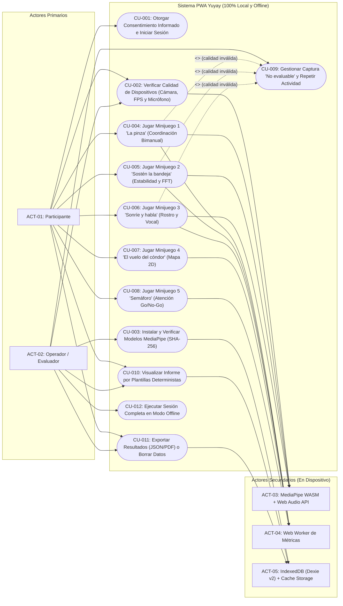

# 03. ESPECIFICACIÓN DE CASOS DE USO (UML / PLANTILLA EXPANDIDA) — PROYECTO YUYAY
**Estándar de Referencia:** UML 2.5 Use Case Modeling / Alistair Cockburn Fully Dressed Use Cases  
**Código Documental:** `YUYAY-UC-2026-V1.0`  
**Equipo:** Los JackersMainsters (ESPOCH) · **Estación Redactora:** Estación Omar (`OMARFIGUEROA`)

---

## 1. Catálogo de Actores del Sistema

| ID Actor | Nombre del Actor | Tipo de Actor | Descripción y Responsabilidad en Yuyay |
|---|---|---|---|
| **ACT-01** | **Participante** | Primario (Humano) | Adulto voluntario que otorga el consentimiento informado y ejecuta los cinco minijuegos interactuando con la cámara, el micrófono y el teclado/pantalla. |
| **ACT-02** | **Operador de Sesión / Evaluador** | Primario (Humano) | Integrante del equipo investigador o profesional acompañante que supervisa la instalación inicial, la calidad de encuadre/iluminación, la revisión del informe técnico y la exportación local de resultados. |
| **ACT-03** | **Subsistema de Visión y Audio Local** | Secundario (Hardware / WASM) | Compuesto por `MediaDevices` (Cámara y Micrófono), `MediaPipe Tasks Vision` (`HandLandmarker`, `FaceLandmarker`, `PoseLandmarker` sobre WASM/WebGL) y `Web Audio API` (`AudioContext` + `AnalyserNode`). |
| **ACT-04** | **Motor Web Worker de Métricas** | Secundario (Hilo de Cómputo) | Hilo secundario (`src/workers/metric.worker.ts`) que ejecuta de forma aislada y determinista las funciones puras de `src/metrics/*`. |
| **ACT-05** | **Almacenamiento Local (Dexie / Cache Storage)** | Secundario (Persistencia) | Base de datos transaccional local `IndexedDB` (`YuyayDb` Dexie v2: tablas `sessions`, `deviceChecks`, `measurements`) y `Cache Storage` (`yuyay-models-v1`). |

---

## 2. Diagrama General de Casos de Uso (UML / Mermaid)

---

## 3. Especificación Detallada de Casos de Uso (`CU-001` a `CU-012`)

---

### `CU-001` — Otorgar Consentimiento Informado e Iniciar Sesión
| Atributo | Especificación |
|---|---|
| **ID y Nombre** | `CU-001`: Otorgar Consentimiento Informado e Iniciar Sesión |
| **Actores** | Primario: `ACT-01` (Participante) · Secundario: `ACT-05` (Dexie `sessions`) |
| **Mockups Asociados** | Pliego 1 — Pantalla 1 (*"Yuyay · Conoce cómo estás"*) y Pantalla 2 (*"Antes de empezar"*) |
| **Precondiciones** | La aplicación se ha cargado en un navegador compatible. |
| **Postcondiciones (Éxito)** | Se crea o actualiza una fila `SessionRow` en la tabla `sessions` con `state = 'devices'` y `startedAt` válido; `yuyay.sessionId` queda almacenado en `localStorage`. |
| **Postcondiciones (Fallo)** | Si el participante no acepta, la sesión permanece en `state = 'consent'` y no se accede a cámara ni micrófono. |
| **Flujo Principal** | 1. El sistema presenta la pantalla de bienvenida/consentimiento (`ConsentScreen.tsx`) mostrando las 3 garantías: procesamiento en el dispositivo, cero almacenamiento de audio/video y posibilidad de borrar resultados, junto con el descargo *"Prototipo experimental. No sustituye una evaluación médica."*. 2. El `Participante` lee las condiciones y marca la casilla *"Soy mayor de 18 años y acepto participar"*. 3. El sistema habilita el botón primario `Continuar`. 4. El `Participante` pulsa `Continuar`. 5. El sistema invoca `flow.acceptConsent()`, transiciona al estado `'devices'`, persiste el `SessionRow` en `Dexie` y renderiza `DeviceCheckScreen`. |
| **Flujos Alternativos** | **FA-1.1 (Sesión previa en curso):** Al montar `App.tsx`, si `localStorage` contiene un `yuyay.sessionId` válido en Dexie cuyo estado es posterior a `'consent'`, el sistema restaura automáticamente dicho estado sin pedir nuevamente el consentimiento. |

---

### `CU-002` — Verificar Calidad de Dispositivos (Cámara, Iluminación, FPS y Micrófono)
| Atributo | Especificación |
|---|---|
| **ID y Nombre** | `CU-002`: Verificar Calidad de Dispositivos (Cámara, Iluminación, FPS y Micrófono) |
| **Actores** | Primarios: `ACT-01` (Participante), `ACT-02` (Operador) · Secundarios: `ACT-03` (MediaPipe/WebAudio), `ACT-05` (Dexie `deviceChecks`) |
| **Mockups Asociados** | Pliego 1 — Pantalla 3 (*"Prepara tu espacio"*) |
| **Precondiciones** | Sesión en estado `'devices'` (`CU-001` completado). |
| **Postcondiciones (Éxito)** | Se guarda un registro `DeviceCheckRow` en Dexie con `quality.ok === true`, `fps`, `resolution` y `micRms`; la sesión avanza al estado `'install'`. |
| **Postcondiciones (Fallo)** | La sesión se mantiene en `'devices'`, se liberan los streams abiertos y se muestra el motivo técnico del bloqueo. |
| **Flujo Principal** | 1. El sistema muestra la pantalla `DeviceCheckScreen.tsx` con recomendaciones de postura/iluminación y el botón `Activar cámara y micrófono`. 2. El `Participante` pulsa el botón (gesto de usuario requerido por el navegador). 3. El sistema solicita `navigator.mediaDevices.getUserMedia({ video: true, audio: true })`. 4. El usuario concede los permisos. 5. El sistema muestra el video espejado en vivo, inicializa `createFpsMeter()`, ejecuta `HandLandmarker` para verificar presencia de mano en encuadre y mide durante una ventana breve la energía acústica con `measureMicRms()`. 6. El sistema evalúa `evaluateQuality({ fps, micRms, landmarksFound })`. 7. Al resultar `quality.ok === true`, el sistema guarda `DeviceCheckRow` en Dexie y habilita el avance a `'install'`. |
| **Flujos de Excepción** | **FE-2.1 (`NotAllowedError` — Permiso denegado):** El sistema registra `flags: ['permission-denied']`, `ok: false`, muestra un `StatusBanner` de error explicando cómo habilitar la cámara/micrófono y ofrece el botón `Reintentar`. **FE-2.2 (`no-signal` — Micrófono mudo, $\text{RMS} < 0.001$):** El sistema marca `ok: false`, informa que el micrófono no registra señal y solicita hablar o verificar el periférico antes de reintentar. **FE-2.3 (`low-fps` — $\text{FPS} < 20$):** El sistema registra el flag de advertencia `'low-fps'` y sugiere cerrar aplicaciones en segundo plano o mejorar la iluminación. |

---

### `CU-003` — Instalar y Verificar Integridad de Modelos Locales (SHA-256)
| Atributo | Especificación |
|---|---|
| **ID y Nombre** | `CU-003`: Instalar y Verificar Integridad de Modelos Locales (SHA-256) |
| **Actores** | Primario: `ACT-02` (Operador) · Secundario: `ACT-05` (`Cache Storage yuyay-models-v1`) |
| **Precondiciones** | Sesión en estado `'install'` (`CU-002` completado con `quality.ok === true`). |
| **Postcondiciones (Éxito)** | Los modelos `hand_landmarker.task`, `face_landmarker.task` y `pose_landmarker_lite.task` están almacenados en `yuyay-models-v1` con hash `SHA-256` verificado; el estado de sesión pasa a `'games'`. |
| **Flujo Principal** | 1. El sistema monta `InstallScreen.tsx` e invoca `installModels(specs, onProgress)`. 2. Por cada modelo declarado en `public/models/checksums.json`, el sistema consulta la caché local `yuyay-models-v1`. 3. Si el modelo no está en caché, lo descarga leyendo el stream de bytes y actualizando `ProgressBar` (`status: 'downloading'`). 4. El sistema calcula `crypto.subtle.digest('SHA-256', buffer)` (`status: 'verifying'`) y lo compara con el hash oficial. 5. Al coincidir todos los hashes (`done === total`, `status: 'ready'`), el sistema habilita el paso a los minijuegos (`flow.finishInstall(true)`). |
| **Flujos Alternativos y Excepción** | **FA-3.1 (Modelos ya cacheados):** Si los modelos ya existen en `yuyay-models-v1` con hash válido, `installModels` concluye instantáneamente sin realizar descargas de red. **FE-3.1 (Hash inválido o corte de red):** El sistema elimina la entrada corrupta de la caché, reintenta una vez y, si persiste el error, establece `status: 'error'`, lista los archivos en `failed` y muestra el botón `Reintentar`. |

---

### `CU-004` — Ejecutar Minijuego 1: "La pinza" (Coordinación Motora Fina Bimanual)
| Atributo | Especificación |
|---|---|
| **ID y Nombre** | `CU-004`: Ejecutar Minijuego 1 "La pinza" |
| **Actores** | Primario: `ACT-01` (Participante) · Secundarios: `ACT-03` (`HandLandmarker`), `ACT-04` (`Web Worker`), `ACT-05` (`Dexie measurements`) |
| **Mockups Asociados** | Pliego 1 — Pantalla 4 · Pliego 2 — Pantalla 16 (*Tutorial*) y Pantalla 17 (*"Ahora, la otra mano"*) |
| **Precondiciones** | Sesión en estado `'games'`, `nextGame === 'pinza'`, modelos verificados. |
| **Postcondiciones** | Filas `pinza.cycles`, `pinza.amplitude` y `pinza.rhythmVariation` guardadas en la tabla `measurements` de Dexie; `'pinza'` añadido a `completedGames`. |
| **Flujo Principal** | 1. El sistema muestra la tarjeta de instrucciones de *La pinza* (Mockup P16): abrir y cerrar pulgar e índice durante 10 s por mano. 2. El `Participante` pulsa `Empezar`. 3. El sistema activa la cámara y `HandLandmarker`, dibuja los puntos de referencia del pulgar (4) e índice (8) y ejecuta la cuenta regresiva de 10 s para la primera mano. 4. En cada frame, el sistema calcula la distancia normalizada $d_{\text{norm}}(t) = \|P_4 - P_8\| / \|P_0 - P_9\|$ y la agrega al arreglo `HandFrame[]`. 5. Al concluir la primera mano, el sistema muestra la pantalla de transición *"Ahora, la otra mano"* (Mockup P17) y repite la captura de 10 s con la segunda mano. 6. El sistema detiene la cámara y envía los frames al `Web Worker` (`runMetricInWorker({ kind: 'pinch', frames })`). 7. El Worker devuelve `{ cycles, amplitude, rhythmVariation }`. 8. El sistema limpia mediciones previas del juego (`clearMeasurementsForGame`), guarda las nuevas filas en Dexie con `status: 'ok'`, muestra el resumen con unidades (`ciclos`, `u.n.`) y al pulsar `Continuar` invoca `flow.finishGame('pinza')`. |
| **Flujos de Excepción** | **FE-4.1 (Captura insuficiente -> `null`):** Si la mano salió del encuadre o se detectaron menos de 2 ciclos válidos, el Worker devuelve `null`; se activa `CU-009` mostrando `"No evaluable"` y permitiendo repetir. |

---

### `CU-005` — Ejecutar Minijuego 2: "Sostén la bandeja" (Estabilidad Postural y FFT)
| Atributo | Especificación |
|---|---|
| **ID y Nombre** | `CU-005`: Ejecutar Minijuego 2 "Sostén la bandeja" |
| **Actores** | Primario: `ACT-01` (Participante) · Secundarios: `ACT-03` (`PoseLandmarker`/`HandLandmarker`), `ACT-04` (`Web Worker`), `ACT-05` (`Dexie measurements`) |
| **Mockups Asociados** | Pliego 1 — Pantalla 5 · Pliego 2 — Pantallas 18 y 19 |
| **Precondiciones** | Sesión en estado `'games'`, `nextGame === 'bandeja'`. |
| **Postcondiciones** | Filas `bandeja.rms`, `bandeja.dominantFrequency` y `bandeja.duration` persistidas en Dexie. |
| **Flujo Principal** | 1. El sistema presenta las instrucciones de *Sostén la bandeja* (Mockup P19): mantener el dispositivo apoyado y sostener manos/brazos visibles. 2. El `Participante` pulsa `Empezar`. 3. El sistema inicia el bucle de captura durante la ventana programada ($15\text{–}20\text{ s}$), registrando en cada cuadro `StabilityFrame { t, x, y }` del centroide de muñecas/manos. 4. Al terminar el conteo, el sistema libera la cámara e invoca `runMetricInWorker({ kind: 'stability', frames })`. 5. El Worker calcula la dispersión postural (`rms` en `u.n.`), la duración (`ms`) y la frecuencia oscilatoria dominante (`Hz` vía FFT). 6. El sistema guarda las mediciones en Dexie, presenta los resultados con sus unidades y avanza al siguiente juego. |
| **Flujos de Excepción** | **FE-5.1 (Brazos/manos fuera de cuadro o $< 2\text{ frames}$):** El Worker retorna `null` y se ejecuta `CU-009` (`"No evaluable"`). |

---

### `CU-006` — Ejecutar Minijuego 3: "Sonríe y habla" (Simetría Facial y Emisión Vocal)
| Atributo | Especificación |
|---|---|
| **ID y Nombre** | `CU-006`: Ejecutar Minijuego 3 "Sonríe y habla" |
| **Actores** | Primario: `ACT-01` (Participante) · Secundarios: `ACT-03` (`FaceLandmarker` + `Web Audio API`), `ACT-04` (`Web Worker`), `ACT-05` (`Dexie measurements`) |
| **Mockups Asociados** | Pliego 1 — Pantalla 6 · Pliego 2 — Pantalla 20 · Pliego 3 — Pantalla 22 |
| **Precondiciones** | Sesión en estado `'games'`, `nextGame === 'sonrisa'`. |
| **Postcondiciones** | Filas `sonrisa.symmetryRatio`, `sonrisa.vowelDuration` y `sonrisa.vowelIntensity` registradas en Dexie; cero audio o video almacenado. |
| **Flujo Principal** | 1. **Subfase Facial (Mockup P6/P22):** El sistema muestra el óvalo de encuadre facial y pide al participante mirar de frente y sonreír durante 5 segundos. 2. `FaceLandmarker` extrae los puntos de referencia de comisuras labiales y línea media facial. 3. **Subfase Vocal (Mockup P20):** El sistema muestra la consigna `"aaa" — Usa tu voz habitual` durante 5 segundos y procesa en tiempo real el buffer de `AnalyserNode` animando las barras de onda acústica. 4. El sistema cierra cámara y micrófono, calcula el índice de simetría geométrica (`u.n.`), la duración continua de la vocal (`s`) y la intensidad media (`dBFS`). 5. El sistema guarda las filas en Dexie y permite avanzar al cuarto minijuego. |
| **Flujos de Excepción** | **FE-6.1 (Rostro ausente o micrófono sin señal por encima del umbral):** La métrica afectada se registra con `value: null`, `status: 'not-evaluable'` y se activa `CU-009` para permitir repetir. |

---

### `CU-007` — Ejecutar Minijuego 4: "El vuelo del cóndor" (Memoria Espacial en Mapa 2D)
| Atributo | Especificación |
|---|---|
| **ID y Nombre** | `CU-007`: Ejecutar Minijuego 4 "El vuelo del cóndor" |
| **Actores** | Primario: `ACT-01` (Participante) · Secundarios: `ACT-04` (`Web Worker`), `ACT-05` (`Dexie measurements`) |
| **Mockups Asociados** | Pliego 1 — Pantalla 7 · Pliego 3 — Pantallas 23, 24 y 25 |
| **Precondiciones** | Sesión en estado `'games'`, `nextGame === 'condor'`. |
| **Postcondiciones** | Filas `condor.hits`, `condor.duration`, `condor.length` y `condor.optimalLength` guardadas en Dexie. |
| **Flujo Principal** | 1. **Fase Tutorial y Observación (Mockups P23 y P7):** El sistema presenta el mapa 2D del valle andino con el punto `Inicio` ($P_0$) y las tres mesetas numeradas `1`, `2` y `3` ($O_1, O_2, O_3$). 2. El `Participante` memoriza las posiciones y pulsa `Ya lo recuerdo / Empezar` (o concluye el temporizador de observación). 3. **Fase de Navegación (Mockup P24):** El sistema oculta los marcadores numéricos, muestra el indicador superior `Destino: meseta 1` (`1 -> 2 -> 3`) y habilita los controles direccionales en pantalla (`<-`, `^`, `->`) y las teclas de dirección. 4. A medida que el participante desplaza al cóndor, el sistema registra `PathPoint { t, x, y }` y comprueba si la distancia euclidiana al objetivo actual $O_k$ es $\le R_{\text{umbral}}$. 5. Al alcanzar $O_3$ (o agotarse el tiempo máximo), el sistema envía `{ kind: 'path', points, hits, total: 3 }` al `Web Worker`. 6. El sistema persiste las métricas en Dexie y avanza al quinto minijuego. |

---

### `CU-008` — Ejecutar Minijuego 5: "Semáforo" (Atención Sostenida e Inhibición Go/No-Go)
| Atributo | Especificación |
|---|---|
| **ID y Nombre** | `CU-008`: Ejecutar Minijuego 5 "Semáforo" |
| **Actores** | Primario: `ACT-01` (Participante) · Secundarios: `ACT-04` (`Web Worker`), `ACT-05` (`Dexie measurements`) |
| **Mockups Asociados** | Pliego 1 — Pantalla 8 · Pliego 3 — Pantallas 26 y 27 |
| **Precondiciones** | Sesión en estado `'games'`, `nextGame === 'semaforo'`. |
| **Postcondiciones** | Filas `semaforo.medianLatency`, `semaforo.omissions` y `semaforo.falseAlarms` guardadas en Dexie; al ser el 5.º juego completado, la sesión transiciona automáticamente a `'report'`. |
| **Flujo Principal** | 1. El sistema muestra la pantalla de instrucciones de *Semáforo* (Mockup P26) explicando la regla con forma y color: **Verde (Círculo con `✓`/`+`) = Tocar el botón**; **Rojo (Octágono con `✋`/`-`) = Esperar**. 2. El `Participante` pulsa `Empezar`. 3. El sistema ejecuta la secuencia de ensayos registrando `stimulusAt = performance.now()`. 4. En cada ensayo, si el usuario presiona el botón `Tocar` o la barra espaciadora, se registra `respondedAt = performance.now()`. 5. Concluida la secuencia, el sistema envía `ReactionTrial[]` al `Web Worker` (`kind: 'reaction'`). 6. El Worker calcula `medianLatency` (`ms`), `omissions` y `falseAlarms`. 7. El sistema guarda las filas en Dexie e invoca `flow.finishGame('semaforo')`, pasando la sesión al estado `'report'`. |

---

### `CU-009` — Gestionar Captura Insuficiente ("No evaluable") y Repetir Actividad
| Atributo | Especificación |
|---|---|
| **ID y Nombre** | `CU-009`: Gestionar Captura Insuficiente ("No evaluable") y Repetir Actividad |
| **Actores** | Primarios: `ACT-01` (Participante), `ACT-02` (Operador) · Secundario: `ACT-05` (`Dexie measurements`) |
| **Precondiciones** | Un minijuego ha concluido su ventana de captura devolviendo métrica `null` o banderas bloqueantes (`hand-absent`, `face-absent`, `no-signal`, `low-fps` severo). |
| **Postcondiciones** | Si el usuario repite, se eliminan las filas previas del juego (`clearMeasurementsForGame`) y se reinicia la actividad; si continúa sin repetir, queda registrado `status: 'not-evaluable'` y `value: null`. |
| **Flujo Principal** | 1. El sistema detecta que el resultado del cálculo es `null`. 2. El sistema persiste en Dexie la fila de la actividad con `value: null`, `status: 'not-evaluable'` y el arreglo `qualityFlags` con la causa técnica. 3. El sistema muestra un `StatusBanner` de advertencia con el estado **"No evaluable"**, explica la causa (ej. *"La mano salió del encuadre"* o *"El micrófono no registró señal"*) y recomienda cómo corregirla. 4. El usuario pulsa `Repetir actividad`. 5. El sistema invoca `clearMeasurementsForGame(sessionId, gameId)` y reinicia el temporizador del minijuego. |

---

### `CU-010` — Generar y Visualizar Informe de Sesión mediante Plantillas Deterministas
| Atributo | Especificación |
|---|---|
| **ID y Nombre** | `CU-010`: Generar y Visualizar Informe de Sesión mediante Plantillas Deterministas |
| **Actores** | Primarios: `ACT-01` (Participante), `ACT-02` (Operador) · Secundario: `ACT-05` (`Dexie`) |
| **Mockups Asociados** | Pliego 1 — Pantalla 9 (*"Tu perfil / Ver informe"*, adaptado a Regla RC-01) |
| **Precondiciones** | Sesión en estado `'report'`. |
| **Postcondiciones** | Se muestra en pantalla el informe completo de las 5 dimensiones y se marca `finishedAt` en la tabla `sessions`. |
| **Flujo Principal** | 1. Al montar `ReportScreen.tsx` (desarrollado en la **Estación Omar**), el sistema consulta `listMeasurements(sessionId)` y `latestDeviceCheck(sessionId)`. 2. El motor puro `report-templates.ts` procesa las filas agrupadas por `gameId` (`pinza`, `bandeja`, `sonrisa`, `condor`, `semaforo`). 3. Para cada actividad con `status === 'ok'`, la plantilla inserta los valores medidos con sus unidades físicas y un párrafo explicativo de qué midió la tarea. 4. Para cualquier actividad con `status === 'not-evaluable'`, la plantilla omite valores numéricos, imprime **"No evaluable"** y detalla el motivo técnico (`qualityFlags`). 5. El sistema presenta el banner fijo obligatorio: *"Prototipo experimental. Estos resultados son descriptivos y no sustituyen una evaluación médica profesional."* |

---

### `CU-011` — Exportar Resultados Localmente (JSON y Vista Imprimible/PDF) y Borrar Datos
| Atributo | Especificación |
|---|---|
| **ID y Nombre** | `CU-011`: Exportar Resultados Localmente (JSON y Vista Imprimible/PDF) y Borrar Datos |
| **Actores** | Primarios: `ACT-01` (Participante), `ACT-02` (Operador) · Secundario: `ACT-05` (`Dexie`) |
| **Mockups Asociados** | Pliego 1 — Pantalla 2 (*Borrar resultados*) y Pantalla 9 (*"Guardar en el dispositivo"*) |
| **Precondiciones** | Informe de sesión visible en pantalla (`CU-010`). |
| **Postcondiciones** | Archivo `.json` descargado en el sistema de archivos local, diálogo de impresión/PDF ejecutado o datos de sesión eliminados de IndexedDB según la acción elegida. |
| **Flujo Principal (Exportación JSON)** | 1. El `Operador` o `Participante` pulsa el botón `Guardar en el dispositivo (JSON)`. 2. El módulo `export-report.ts` construye un objeto serializable que contiene: versión de la app, `sessionId`, `startedAt`, `finishedAt`, resumen de `deviceCheck` y el arreglo de `measurements` (verificando que no incluya datos crudos). 3. El sistema crea un `Blob` con tipo `application/json` y dispara la descarga local `yuyay-informe-<sessionId>.json`. |
| **Flujos Alternativos** | **FA-11.1 (Imprimir / Guardar PDF):** El usuario pulsa `Imprimir / Guardar PDF`; el sistema invoca `window.print()` aplicando las clases `@media print` para generar un documento limpio de 1–2 páginas. **FA-11.2 (Borrar resultados locales):** El usuario pulsa `Borrar mis resultados`; el sistema elimina las entradas de la sesión en `measurements`, `deviceChecks` y `sessions`, limpia `localStorage` y reinicia el flujo en `consent`. |

---

### `CU-012` — Ejecutar Sesión Completa en Modo Desconectado (100 % Offline)
| Atributo | Especificación |
|---|---|
| **ID y Nombre** | `CU-012`: Ejecutar Sesión Completa en Modo Desconectado (100 % Offline) |
| **Actores** | Primario: `ACT-02` (Operador) · Secundario: `ACT-05` (`Service Worker` + `Cache Storage`) |
| **Precondiciones** | La PWA y los modelos de `yuyay-models-v1` fueron instalados y verificados previamente (`CU-003`). |
| **Postcondiciones** | La sesión completa (`CU-001` a `CU-011`) se ejecuta con la tarjeta de red desconectada y `0` solicitudes externas fallidas. |
| **Flujo Principal** | 1. El `Operador` apaga el Wi-Fi / desconecta la red del portátil (ej. en el Auditorio FIE o en una comunidad rural). 2. El `Operador` abre o recarga la URL de la PWA instalada. 3. El Service Worker (Workbox) intercepta la navegación y entrega `/index.html`, los bundles JS/CSS desde precache y los archivos `/models/*.task` y `/models/wasm/*` desde `Cache Storage` (`CacheFirst`). 4. Se ejecutan los cinco minijuegos, el cálculo en el Web Worker, el almacenamiento en IndexedDB y la exportación del informe sin ninguna dependencia de red. |
