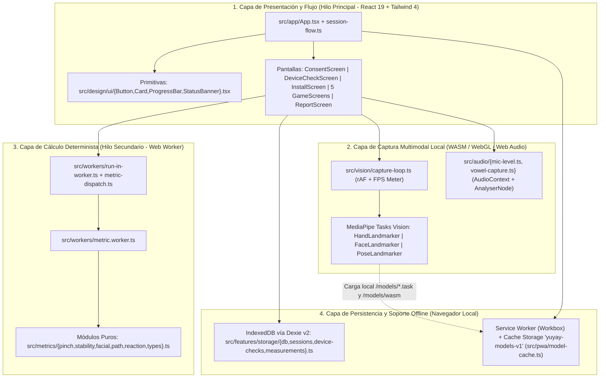
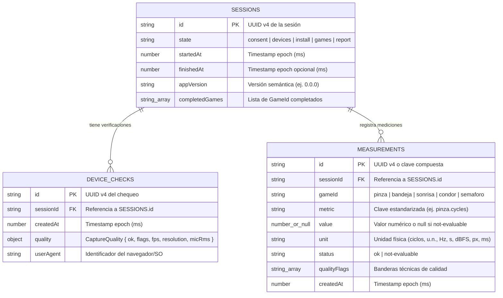

# 05. DOCUMENTO DE ARQUITECTURA DE SOFTWARE, DISEÑO UI (MOCKUPS) Y MODELO DE DATOS (SAD/SDD)
**Estándar de Referencia:** IEEE Std 1016-2009 (Software Design Descriptions) + Modelo C4  
**Código Documental:** `YUYAY-SAD-2026-V1.0`  
**Equipo:** Los JackersMainsters (ESPOCH) · **Estación Redactora:** Estación Omar (`OMARFIGUEROA`)

---

## 1. Arquitectura General del Sistema (Client-Side Offline-First PWA)

Yuyay implementa una arquitectura **monolítica modular en el cliente (*Clean Client-Side Architecture*)**, dividida en cuatro capas desacopladas que se comunican mediante contratos estrictamente tipados en TypeScript 7.

---

## 2. Mapeo Técnico Exhaustivo: Mockups (`PROPUESTA/mockups/`) $\rightarrow$ Componentes y Diseño

A continuación se documenta cómo cada una de las **27 vistas contenidas en los tres archivos de mockups** se traduce a la arquitectura real de componentes en `Desarrollo/yuyay/src/`:

### 2.1. Pliego 1: `45de6305-9126-482c-ace6-13c713a2b844.jpg` (*"Yuyay · Propuesta móvil"*)

| Pantalla en Mockup | Título Visible en Mockup | Ruta de Componente en `yuyay` | Primitivas y Tokens Usados | Reglas de Ingeniería Aplicadas |
|---|---|---|---|---|
| **M1-P1** | *"Yuyay · Conoce cómo estás"* | Integrado en `src/features/consent/ConsentScreen.tsx` | `Card`, `Button (primary)`, `--color-surface`, `--color-accent` | Presenta el propósito exploratorio (~5–6 min) y el aviso *"Prototipo experimental. No emite diagnósticos."* (`copy.ts`). |
| **M1-P2** | *"Antes de empezar"* | `src/features/consent/ConsentScreen.tsx` | `Card`, `StatusBanner (info)`, `checkbox`, `Button` | Muestra las 3 garantías: procesamiento local, no grabación de audio/video y borrado de datos. Bloquea `acceptConsent()` hasta marcar el checkbox. |
| **M1-P3** | *"Prepara tu espacio"* | `src/features/devices/DeviceCheckScreen.tsx` + `src/features/install/InstallScreen.tsx` | `Card`, `StatusBanner`, `ProgressBar`, `Button` | Valida iluminación/encuadre, cámara ($\ge 20\text{ FPS}$), micrófono ($\text{RMS} \ge 0.001$) y descarga verificada `SHA-256` de modelos en `yuyay-models-v1`. |
| **M1-P4** | *"Juego 1 de 5 · La pinza"* | `src/features/games/pinza/PinzaScreen.tsx` | `Card`, `<video>` espejado, `<canvas>` overlay, `Button` | Dibuja landmarks del pulgar (4) e índice (8), temporizador `00:10` por mano y estado de encuadre. |
| **M1-P5** | *"Juego 2 de 5 · Sostén la bandeja"* | `src/features/games/bandeja/BandejaScreen.tsx` | `Card`, `<video>`, guía horizontal SVG/Canvas, `Button` | Registra coordenadas $(x, y, t)$ de manos/muñecas durante `00:20` con dispositivo apoyado. |
| **M1-P6** | *"Juego 3 de 5 · Sonríe y habla"* | `src/features/games/sonrisa/SonrisaScreen.tsx` | `Card`, `<video>` con óvalo guía SVG, visualizador de onda | Captura los 478 puntos de `FaceLandmarker` al sonreír y el nivel acústico de la vocal `"aaa"`. |
| **M1-P7** | *"Juego 4 de 5 · El vuelo del cóndor"* | `src/features/games/condor/CondorScreen.tsx` | `Card`, `<svg>` / `<canvas>` 2D, `Button` | Muestra el mapa andino 2D con bandera `Inicio` y mesetas `1`, `2` y `3` durante la fase de codificación. |
| **M1-P8** | *"Juego 5 de 5 · Semáforo"* | `src/features/games/semaforo/SemaforoScreen.tsx` | `Card`, figura SVG accesible, `Button` ($\ge 48\text{ px}$) | Renderiza estímulo Go (Círculo Verde con `✓`/`+`) y botón `Tocar` con medición `performance.now()`. |
| **M1-P9** | *"Tu perfil"* / Informe | `src/features/report/ReportScreen.tsx` | `Card`, `StatusBanner`, `Button (primary/secondary)` | **Reconciliación Normativa (RC-01):** Sustituye los semáforos ilustrativos (`Esperado`/`Revisar`) por **valores medidos con unidades físicas, calidad de captura (`Válida` / `No evaluable`) y plantillas deterministas**, más botones `Ver/Imprimir informe` y `Guardar en el dispositivo (JSON)`. |

### 2.2. Pliego 2: `26c8584f-18e1-4d89-b113-a7b3b41d9f8c.jpg` (*"Yuyay · Movimiento y voz"*)

| Pantalla en Mockup | Título Visible en Mockup | Subestado del Componente | Especificación de Interacción |
|---|---|---|---|
| **M2-P16** | *"Juego 1 de 5 · La pinza"* (Tutorial) | `PinzaScreen` (`step = 'intro'`) | Pasos numerados 1, 2 y 3, badge `10 segundos por mano`, botón `Practicar` (ensayo breve de 3 s sin guardar) y botón `Empezar >`. |
| **M2-P17** | *"Ahora, la otra mano"* | `PinzaScreen` (`step = 'switch-hand'`) | Badge `Mano izquierda`, descanso con cuenta regresiva circular `3` y botón `Estoy listo >` para iniciar la segunda serie de 10 s. |
| **M2-P18** | *"Sostén la bandeja · Paso 1 de 2 · En reposo"* | `BandejaScreen` (`step = 'rest'`) | Captura de línea base de estabilidad durante `00:15` con manos apoyadas/relajadas y botón `Pausar`. |
| **M2-P19** | *"Sostén la bandeja"* (Instrucciones) | `BandejaScreen` (`step = 'intro'`) | Explicación visual de los dos pasos (*1. Relaja las manos*, *2. Extiende ambos brazos*), aviso de mantener el dispositivo apoyado y botón `Empezar >`. |
| **M2-P20** | *"Sonríe y habla · Mantén la vocal"* | `SonrisaScreen` (`step = 'vowel'`) | Consigna grande `"aaa" — Usa tu voz habitual`, barras dinámicas de amplitud RMS en tiempo real, temporizador `00:05` y etiqueta `Procesando en este dispositivo`. |
| **M2-P21** | *"Sonríe y habla · Lee en voz alta"* | Documentado como Extensión Post-MVP | De acuerdo con la Propuesta Técnica Fase 1 (§1 y §2), el MVP evalúa la vocal sostenida (`M2-P20`); la lectura de frase completa queda fuera del núcleo de 5 semanas. |

### 2.3. Pliego 3: `e808711f-d5de-42c9-a0ff-a47bd2d15e2a.jpg` (*"Yuyay · Navegación y atención"*)

| Pantalla en Mockup | Título Visible en Mockup | Subestado del Componente | Especificación de Interacción |
|---|---|---|---|
| **M3-P22** | *"Expresiones faciales"* | `SonrisaScreen` (`step = 'face'`) | Indicador de secuencia (`Relaja` $\rightarrow$ `Sonríe`), marco facial y temporizador `00:05` para calcular el índice de simetría geométrica de comisuras. |
| **M3-P23** | *"Tutorial del cóndor · El vuelo del cóndor"* | `CondorScreen` (`step = 'intro'`) | Explicación en 3 pasos (*1. Observa el mapa*, *2. Visita 1, 2 y 3 en orden*) y botón `Empezar >`. |
| **M3-P24** | *"El vuelo del cóndor (en juego)"* | `CondorScreen` (`step = 'navigate'`) | Barra de estado de objetivos (`1 ✓` — `2 ->` — `3`), lienzo 2D con el cóndor, botones direccionales táctiles (`<-`, `^`, `->`) + soporte de flechas de teclado y reloj `00:42`. |
| **M3-P25** | *"¿Dónde comenzaste?"* | `CondorScreen` (`step = 'origin-angle'`, opcional) | Selector angular con flecha giratoria hacia el punto de partida $P_0$; las métricas primarias comprometidas en el MVP son `hits`, `duration` y `length`. |
| **M3-P26** | *"Tutorial del semáforo"* | `SemaforoScreen` (`step = 'intro'`) | Tarjeta de correspondencia accesible: **Verde (Círculo con check) = toca el botón**; **Rojo (Octágono/Círculo con mano) = espera**. Botones `Practicar >` y `Empezar >`. |
| **M3-P27** | *"Semáforo (en juego)"* | `SemaforoScreen` (`step = 'trial-nogo'`) | Estímulo inhibitorio Rojo con icono de mano blanca de alto, etiqueta `Espera`, reloj `00:22`, botón `Tocar` y botón `Pausar`. |

---

## 3. Modelo de Datos y Diccionario de Entidades (`IndexedDB` / `Dexie.js` v2)

La base de datos local se denomina **`yuyay`** (`src/features/storage/db.ts`, versión de esquema `2`) y consta exclusivamente de tres tablas transaccionales sin ningún campo binario multimedia:

### 3.1. Diagrama Entidad-Relación (Mermaid `erDiagram`)

### 3.2. Diccionario Estandarizado de Claves `metric` en la Tabla `measurements`
Este diccionario es el contrato de integración entre los minijuegos (Andrés y Alexander) y el módulo de Informe por Plantillas (Omar en Estación Omar):

| `gameId` | Clave `metric` | Tipo `value` | Unidad (`unit`) | Descripción Técnica y Origen del Cálculo |
|---|---|---|---|---|
| `pinza` | `pinza.cycles` | `number \| null` | `'ciclos'` | Ciclos completos de apertura/cierre pulgar-índice (`countPinchCycles`, histéresis $0.25 / 0.35$). |
| `pinza` | `pinza.amplitude` | `number \| null` | `'u.n.'` | Amplitud media de apertura normalizada por el tamaño de la palma (`pinchMetrics`). |
| `pinza` | `pinza.rhythmVariation` | `number \| null` | `'proporción'` | Coeficiente de variación ($\sigma / \mu$) de los intervalos entre cierres sucesivos (`pinchMetrics`). |
| `bandeja` | `bandeja.rms` | `number \| null` | `'u.n.'` | Dispersión cuadrática media respecto al centroide postural de las manos (`stabilityMetrics`). |
| `bandeja` | `bandeja.dominantFrequency` | `number \| null` | `'Hz'` | Frecuencia pico de oscilación postural entre $2\text{ y }12\text{ Hz}$ estimada por FFT. |
| `bandeja` | `bandeja.duration` | `number \| null` | `'ms'` | Duración efectiva de la ventana de estabilidad analizada (`stabilityMetrics`). |
| `sonrisa` | `sonrisa.symmetryRatio` | `number \| null` | `'u.n.'` | Razón de simetría geométrica entre el desplazamiento de comisuras izquierda y derecha ($0..1$). |
| `sonrisa` | `sonrisa.vowelDuration` | `number \| null` | `'s'` | Duración continua de la emisión de la vocal `"aaa"` por encima del umbral de ruido. |
| `sonrisa` | `sonrisa.vowelIntensity` | `number \| null` | `'dBFS'` | Nivel medio de intensidad acústica relativa durante la fonación sostenida. |
| `condor` | `condor.hits` | `number \| null` | `'aciertos'` | Número de mesetas objetivo ($0\text{ a }3$) alcanzadas en el orden correcto $1 \rightarrow 2 \rightarrow 3$. |
| `condor` | `condor.duration` | `number \| null` | `'s'` | Tiempo empleado en completar el recorrido por el mapa 2D (`pathMetrics`). |
| `condor` | `condor.length` | `number \| null` | `'px'` | Longitud euclidiana total de la polilínea recorrida por el cóndor (`pathMetrics`). |
| `condor` | `condor.optimalLength` | `number \| null` | `'px'` | Suma de distancias en línea recta $\|O_1 - P_0\| + \|O_2 - O_1\| + \|O_3 - O_2\|$. |
| `semaforo` | `semaforo.medianLatency` | `number \| null` | `'ms'` | Mediana de tiempos de respuesta ($t_{\text{resp}} - t_{\text{stim}}$) en ensayos `go` acertados (`reactionMetrics`). |
| `semaforo` | `semaforo.omissions` | `number \| null` | `'ensayos'` | Total de estímulos `go` en los que el participante no respondió dentro de la ventana. |
| `semaforo` | `semaforo.falseAlarms` | `number \| null` | `'ensayos'` | Total de estímulos `nogo` en los que el participante presionó por error (comisiones). |

---

## 4. Diseño Matemático y Algorítmico de las Métricas Puras (`src/metrics/`)

1. **Histéresis y Ritmo en `"La pinza"` (`src/metrics/pinch.ts`):**
   - Sea $p_i \in [0, 1]$ la distancia pulgar-índice normalizada en el instante $t_i$.
   - El detector de estados con histéresis transiciona a `CLOSED` cuando $p_i < \theta_{\text{close}} = 0.25$ y cuenta $+1\text{ ciclo}$ al regresar a `OPEN` cuando $p_i > \theta_{\text{open}} = 0.35$.
   - Si el número de ciclos $C < 2$, devuelve `null` (`"No evaluable"`).
   - Sean $\Delta t_k = t_{\text{cierre}, k+1} - t_{\text{cierre}, k}$ los intervalos entre cierres consecutivos; la variación del ritmo se calcula como:
     $$\text{rhythmVariation} = \frac{\sqrt{\frac{1}{M}\sum_{k=1}^{M}(\Delta t_k - \bar{\Delta t})^2}}{\bar{\Delta t}}$$

2. **Estabilidad y Frecuencia Oscilatoria en `"Sostén la bandeja"` (`src/metrics/stability.ts`):**
   - Sea $(x_i, y_i)$ la posición normalizada en el instante $t_i$ ($i = 1 \dots N$). Con centroide $(\bar{x}, \bar{y})$, la dispersión postural es:
     $$\text{rms} = \sqrt{\frac{1}{N}\sum_{i=1}^{N}\left[(x_i - \bar{x})^2 + (y_i - \bar{y})^2\right]}$$
   - Para estimar la frecuencia dominante frente al muestreo irregular de cámara (`requestAnimationFrame`), la serie vertical centrada $\tilde{y}(t_i) = y_i - \bar{y}$ se remuestrea linealmente a una rejilla uniforme de $f_s = 32\text{ Hz}$, se multiplica por una ventana de Hann $w[n] = 0.5\left(1 - \cos\left(\frac{2\pi n}{L-1}\right)\right)$ y se evalúa la magnitud espectral $|Y(f)|$ en la banda de interés $[2\text{ Hz}, 12\text{ Hz}]$, identificando el pico con interpolación parabólica para lograr un error $\le 0.5\text{ Hz}$ en señales de $3, 5\text{ y }8\text{ Hz}$.

3. **Simetría Facial y Vocal en `"Sonríe y habla"` (`src/metrics/facial.ts`, `src/audio/vowel-capture.ts`):**
   - Dados los landmarks de la comisura labial izquierda $L_{61}$, comisura derecha $L_{291}$ y el vector unitario del eje medio facial $\hat{u}_{\text{mid}}$ (definido entre el puente nasal $L_{6}$ y el mentón $L_{152}$), se proyectan las distancias perpendiculares $d_L$ y $d_R$ al eje medio durante la sonrisa:
     $$\text{symmetryRatio} = \frac{\min(d_L, d_R)}{\max(d_L, d_R)} \in [0, 1]$$
   - En la señal de audio $x[n]$, para cada bloque de $N_w$ muestras se calcula $\text{RMS}_k = \sqrt{\frac{1}{N_w}\sum x^2[n]}$ y su nivel en decibelios $\text{dBFS}_k = 20\log_{10}(\max(\text{RMS}_k, 10^{-5}))$.

4. **Recorrido 2D en `"El vuelo del cóndor"` (`src/metrics/path.ts`):**
   - Longitud real acumulada sobre los $N$ puntos muestreados:
     $$L_{\text{real}} = \sum_{i=1}^{N-1} \sqrt{(x_{i+1} - x_i)^2 + (y_{i+1} - y_i)^2}$$

5. **Latencia e Inhibición en `"Semáforo"` (`src/metrics/reaction.ts`):**
   - Sea $\mathcal{L}_{\text{go}} = \{ \text{respondedAt}_j - \text{stimulusAt}_j \mid \text{kind}_j = \text{'go'} \land \text{respondedAt}_j \neq \text{null} \land \text{correct}_j \}$ ordenado de menor a mayor; se reporta su mediana exacta, el conteo de omisiones ($\text{kind} = \text{'go'} \land \text{respondedAt} = \text{null}$) y el conteo de falsas alarmas ($\text{kind} = \text{'nogo'} \land \text{respondedAt} \neq \text{null}$).
